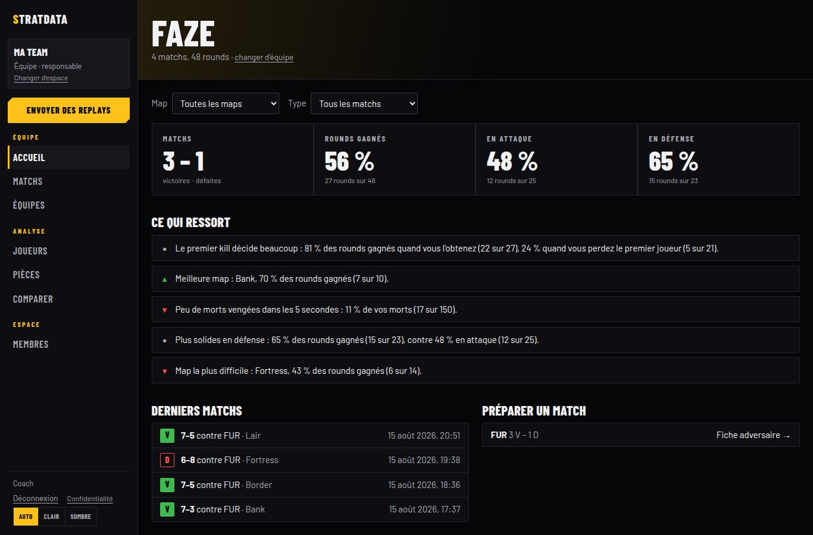
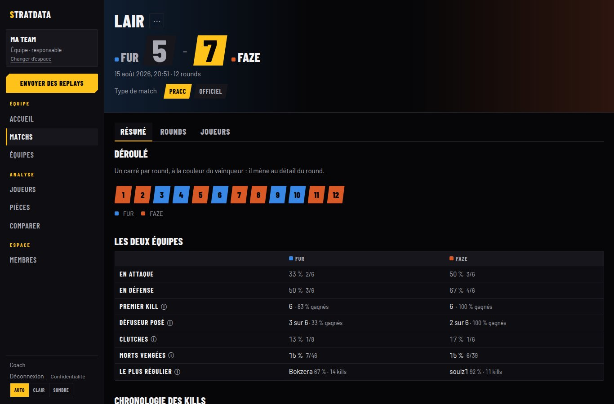
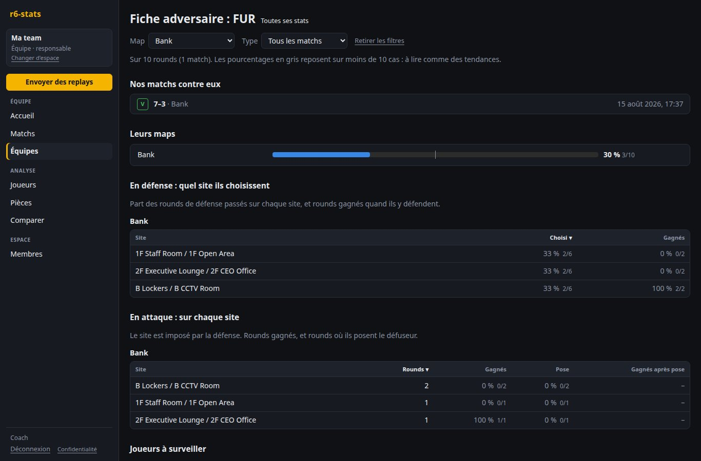
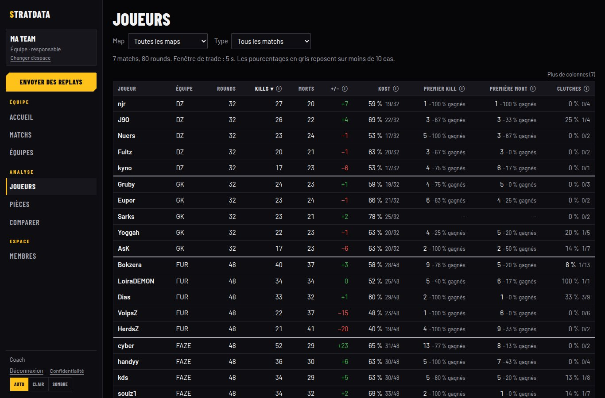
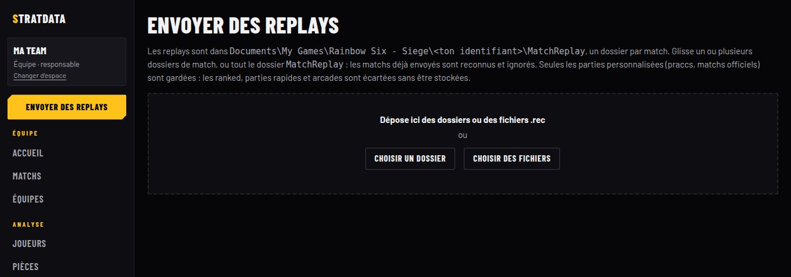
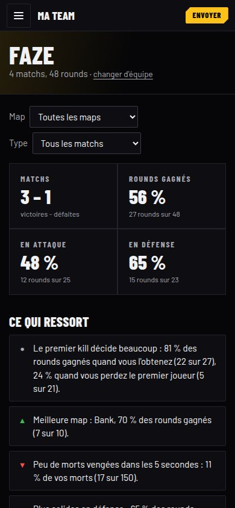
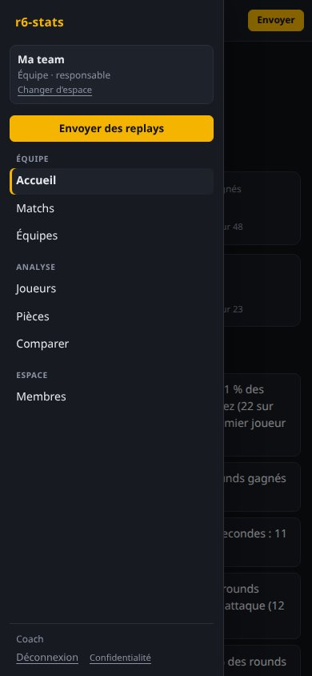

# r6-stats

Statistiques avancées de matchs Rainbow Six Siege, calculées à partir des fichiers de replay `.rec` du jeu.

Le parser est écrit de zéro en Go. Il est validé sur des replays de la saison Y11S2 ; les autres saisons ne sont pas prises en charge pour l'instant.

## Aperçu

Les captures utilisent des données réelles, tirées de compétitions professionnelles : les replays de l'Esports World Cup 2026 (DarkZero – Geekay, et la grande finale FURIA – FaZe), dont les résultats sont publics. L'accueil est vu depuis l'espace de FaZe. Les fichiers de replay eux-mêmes ne sont pas fournis avec le dépôt.

**Accueil d'une équipe** : bilan, chiffres clés, constats en clair (toujours avec le nombre de rounds derrière), derniers matchs.



**Page d'un match** : score, déroulé des rounds, les deux équipes comparées, chronologie des kills ; rounds et joueurs dans leurs onglets.



**Fiche adversaire** : pour préparer un match, ici sur Bank : sites choisis en défense, attaque site par site, joueurs à surveiller, opérateurs, rythme, pièces.



**Joueurs** : les colonnes essentielles, les autres sur demande, une aide ⓘ par colonne.



**Envoi des replays** : on glisse le dossier `MatchReplay` du jeu, les matchs déjà envoyés sont reconnus.



**Sur téléphone** : la même interface, avec un menu en tiroir et des fiches à la place des tableaux.

<p>
  
  
</p>

## Ce qui est décodé

- **En-tête** : map, équipes, score avant le round, joueurs avec opérateur et côté (attaque/défense), version du jeu.
- **Événements** : kills horodatés (tueur, victime, headshot), pose du défuseur, poseur et désamorceur, site de bombe, vainqueur du round et raison.
- **Positions** : pièce où se trouve chaque joueur pendant le round, et pièce du tueur et de la victime pour chaque kill.
- **Matchs** : regroupement des rounds en matchs, y compris les parties privées rehostées (les enregistrements de rounds interrompus sont écartés).

## Statistiques

- Assists, lus dans le tableau des scores du jeu.
- KOST : part des rounds avec un kill, une pose ou un désamorçage, une survie ou une mort tradée, et taux de survie.
- Duels d'ouverture : premier kill et première mort, avec le taux de victoire du round qui suit.
- Trades : morts vengées dans les 5 secondes, kills de vengeance.
- Clutches : situations 1vX rencontrées et gagnées.
- Avantages numériques : taux de victoire par situation (5v4, 3v2, 1v3…).
- Sites de bombe : taux de victoire en attaque et en défense, et taux de pose, par site.
- Poses et désamorçages par joueur, avec les rounds gagnés après pose.
- Pièces : kills et morts par pièce et par côté, et par joueur.
- Ventilation des stats des joueurs par côté, map et opérateur, et des équipes par côté et map.
- Moment du round : kills et morts par tranche de 30 secondes.

## Utilisation

Prérequis : Go 1.25 ou plus récent.

```sh
go run ./cmd/r6rec ls <dossier>        # liste les rounds trouvés
go run ./cmd/r6rec matches <dossier>   # matchs reconstitués, round par round
go run ./cmd/r6rec stats <dossier>     # statistiques (ajouter -json pour la sortie JSON)
go run ./cmd/r6rec rooms <dossier>     # kills et morts par pièce
go run ./cmd/r6rec split side <dossier>  # stats par côté (aussi : map, operator)
go run ./cmd/r6rec round <fichier.rec> # événements d'un round en JSON
```

### Interface web

```sh
go run ./cmd/r6rec serve Replays          # API sur http://127.0.0.1:8642
cd web && npm install && npm run dev      # interface sur http://localhost:5173
```

L'interface s'ouvre sur le tableau de bord de ton équipe et propose une fiche de préparation contre chaque adversaire. Elle permet aussi de comparer deux joueurs. Toutes les stats peuvent être filtrées par map ; le filtre se garde dans l'adresse de la page.

Pour servir l'interface construite directement depuis l'outil (Node n'est alors nécessaire que pour la construire) :

```sh
cd web && npm run build && cd ..
go run ./cmd/r6rec serve -web web/dist Replays   # tout sur http://127.0.0.1:8642
```

Le type de chaque match (pracc ou officiel) et ton équipe se choisissent dans l'interface ; ils sont enregistrés dans un fichier de ton dossier de configuration (`-data` pour en choisir un autre).

Chaque replay n'est décodé qu'une fois : le résultat est gardé dans le dossier de cache de l'utilisateur (`r6rec cache info` pour le voir, `r6rec cache clear` pour le vider, `R6STATS_CACHE=off` pour s'en passer).

### Serveur partagé (en construction)

`r6server` garde les matchs de plusieurs espaces (une équipe, une ligue) dans une base SQLite. Chaque replay n'y est décodé qu'une fois, et les données extraites suffisent à tout afficher.

```sh
go run ./cmd/r6server create "Ma team" team   # affiche l'identifiant de l'espace
go run ./cmd/r6server import <id> Replays     # envoie les replays d'un dossier
go run ./cmd/r6server serve                   # API sur http://127.0.0.1:8642
go run ./cmd/r6server delete <id>             # supprime un espace (demande son nom)
```

On s'y connecte avec Discord. Chaque espace a ses responsables (capitaine, coach), qui invitent par lien, et ses joueurs. Un espace n'est visible que de ses membres. Un responsable peut supprimer l'espace (bouton « Supprimer » dans la liste des espaces, ou en bas de la page Membres) : ses matchs et invitations partent avec lui.

Pour activer la connexion Discord :

1. Sur <https://discord.com/developers/applications>, créer une application (gratuit).
2. Dans **OAuth2**, ajouter la redirection `http://127.0.0.1:8642/auth/callback` (ou `<adresse du site>/auth/callback` une fois en ligne), puis copier le **Client ID** et le **Client Secret**.
3. Lancer le serveur avec ces valeurs :

```sh
R6_DISCORD_CLIENT_ID=… R6_DISCORD_CLIENT_SECRET=… go run ./cmd/r6server serve
```

Une page de confidentialité (`/privacy`) explique ce qui est gardé et pourquoi. Chacun peut télécharger ses données ou supprimer son compte ; un responsable peut supprimer un match ou un espace. Le nom de l'exploitant et l'adresse de contact se règlent par `R6_OPERATOR` et `R6_CONTACT`.

Pour le mettre en ligne (VPS, HTTPS, sauvegardes) : voir [deploy/README.md](deploy/README.md).

`R6_CREATORS` (identifiants Discord séparés par des virgules) limite la création d'espaces pendant la bêta. Pour essayer sans Discord, sur ta machine seulement : `serve -dev-login`, puis ouvrir `http://127.0.0.1:8642/auth/dev?name=Coach`.

Sous Windows, les replays sont dans le dossier `MatchReplay` du jeu, avec un sous-dossier par match.

Pour installer l'outil sans cloner le dépôt :

```sh
go install github.com/pdrillin/r6-stats/cmd/r6rec@latest
```

Pour produire l'exécutable Windows depuis n'importe quel système :

```sh
GOOS=windows GOARCH=amd64 go build -o r6rec.exe ./cmd/r6rec
```

## Organisation du code

| Dossier | Rôle |
|---|---|
| `rec/` | Lecture des fichiers `.rec` : en-tête, décompression, événements du round |
| `cache/` | Cache des rounds décodés |
| `store/` | Données saisies par l'utilisateur (type des matchs, équipe) |
| `match/` | Regroupement des rounds en matchs, gestion des rehosts |
| `stats/` | Calcul des statistiques |
| `api/` | API JSON servie à l'interface web |
| `server/` | Serveur partagé : espaces, envoi des replays, base SQLite |
| `cmd/r6rec/` | Outil en ligne de commande |
| `web/` | Interface web (React, TypeScript, Vite) |

## Captures d'écran

Les images de l'aperçu se refont d'une commande, à relancer après un changement visible de l'interface. Il faut le corpus `Replays/`, Chrome ou Chromium, et un serveur vide lancé avec la connexion de développement :

```sh
cd web && npm run build && cd ..
go run ./cmd/r6server -data /tmp/r6-captures serve -dev-login -web web/dist
cd web && npm run screenshots    # dans un autre terminal ; écrit docs/screenshots/
```

Variables utiles : `R6_URL` (adresse du serveur), `R6_REPLAYS` (dossier des replays), `CHROME` (navigateur à utiliser).

## Tests

```sh
go test ./...
```

Une partie des tests tourne sur de vrais replays placés dans `Replays/` à la racine. Ce dossier n'est pas versionné (taille et droits) : sans lui, ces tests sont ignorés et seuls les tests unitaires s'exécutent.
